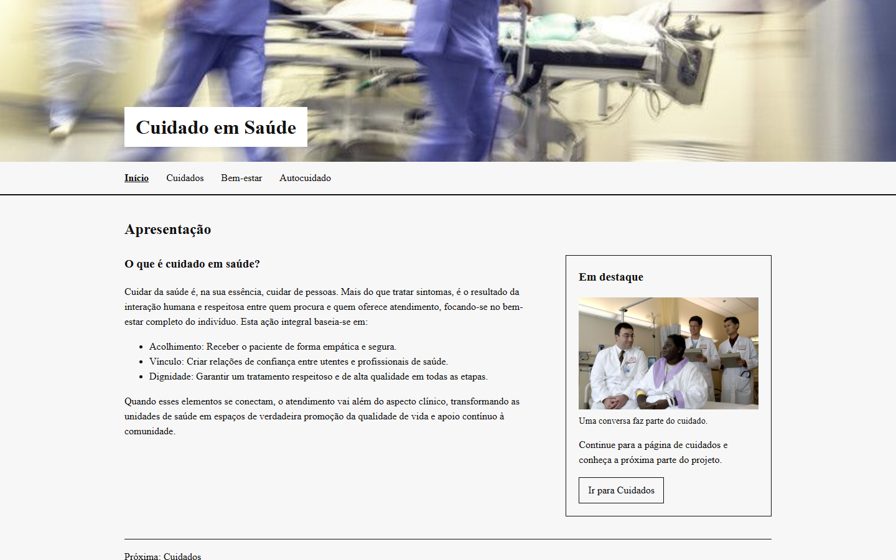
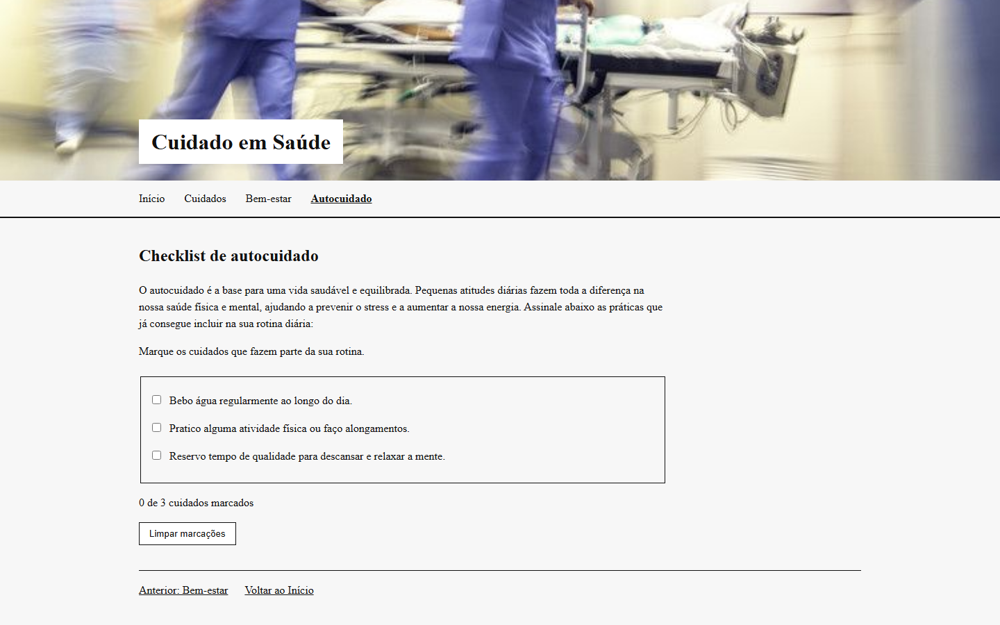

# Cuidado em Saúde

Projeto acadêmico da disciplina de Desenvolvimento Web do curso de Análise e Desenvolvimento de Sistemas da Unisinos. O site apresenta informações introdutórias sobre cuidado em saúde em quatro páginas.

## Início

A página inicial apresenta o tema, os links de navegação e um conteúdo em destaque que leva à página de Cuidados.

## Cuidados

A página reúne um texto sobre cuidados no dia a dia e um vídeo incorporado do YouTube para complementar a leitura.

## Bem-estar

Três conteúdos abordam saúde física, saúde mental e rede de acolhimento, cada um com imagem e texto.

## Autocuidado

Um checklist de três práticas permite marcar e desmarcar itens. O JavaScript atualiza a contagem, mostra uma mensagem quando todos estão marcados e permite limpar as marcações.

## Tecnologias

HTML para a estrutura das páginas, CSS para a apresentação e JavaScript para o checklist e o rodapé comum.

## Como visualizar

Abra `index.html` em um navegador e use o menu para acessar as demais páginas. O vídeo incorporado precisa de conexão com a internet.

## Autor

Thiago Aparecido Da Silva Rodrigues — Desenvolvimento Web, Unisinos.
